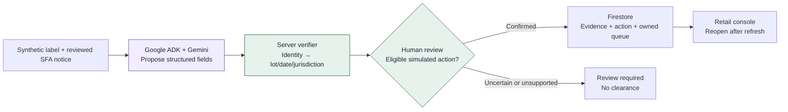

# BatchBeacon AI

**From the product in hand to the recall evidence that matters — and a human-confirmed response.**

[](https://github.com/imrohitagrawal/batchbeacon-ai/actions/workflows/checks.yml)
[](https://batchbeacon.stackclimb.com)


**[Launch live demo](https://batchbeacon.stackclimb.com) · [5-step judge walkthrough](docs/submission/judge-guide.md) · [Architecture](docs/submission/architecture.md) · [Evidence and limitations](docs/submission/evidence-index.md)**

BatchBeacon AI is a working, bounded **retail recall investigation prototype** built for **Singapore AI Builder Cup 2026 (Retail & Commerce)** by **Bugging Debuggers**. A retail worker can inspect a *synthetic* product label against a *selected, reviewed historical* Singapore Food Agency (SFA) recall notice. Google Gemini, called through one bounded Google Agent Development Kit (ADK) extraction workflow, proposes label fields. **Deterministic server rules check product identity before lot, dates and jurisdiction.** A person reviews the evidence and explicitly records a **simulated hold**; Firestore preserves the investigation in that guest shop's queue.

The distinctive proposition is an **inspectable package → evidence → verification → decision → handover** workflow. This is a demonstrated integration and design approach, **not a claim of market exclusivity, model superiority or food-safety certification**.

## See it work

| Step | What the judge can verify |
| --- | --- |
| 1. Start | Open the [public app](https://batchbeacon.stackclimb.com), optionally take the five-step guided tour and select the **Camembert Superieur Au Lait Cru** synthetic sample. |
| 2. Extract | Choose **Use this label**, then **Extract and check**. The live path uses an actual Google ADK/Gemini request, subject to the finite public allowance. |
| 3. Verify | Read the proposed fields *beside* the historical SFA conditions. Product identity is checked before lot/date/scope; missing or uncertain information stays in review. |
| 4. Decide | Inspect the evidence and explicitly confirm a **simulated hold** when the verified case permits it. No real inventory is changed. |
| 5. Resume | Refresh and reopen the saved case from the **retail operations console**. Records are limited to that expiring guest shop. |

The [judge guide](docs/submission/judge-guide.md) covers the exact controls, the wrong-product/same-lot counterexample, owner isolation and allowance exhaustion. The [Cloud Run fallback](https://batchbeacon-ai-xotgrrfbcq-el.a.run.app) remains available; **guest sessions do not transfer between hostnames**. Please do not repeatedly trigger paid extraction to test recovery after an uncertain response.

## What is delivered, and what is not

| Capability | Status | Boundary |
| --- | --- | --- |
| Historical SFA investigation with an actual model extraction | **Demonstrated** | A narrow, reviewed source set and synthetic labels; not continuous regulatory coverage |
| Typed AI proposals plus deterministic identity-first verification | **Implemented and exercised** | Model output cannot grant clearance, override evidence or approve inventory action |
| Human-confirmed simulated hold and persistent case queue | **Demonstrated** | Owned, expiring guest sessions; no real stock mutation or cross-device account recovery |
| Retail operations console | **Available** | Guest-shop counts, cases, evidence status, actions and capture guidance |
| Bounded guidance evaluation, activation and rollback | **Tested on deployed service** | Six fixed cases/nine variants; controlled wording only, not auto-changing safety rules |
| Private BatchBeacon Operations | **Configured and inspected** | Cloud resource/monitoring/alert/cost oversight; not a public guest dashboard or completed operational SLO |
| Live multi-authority ingestion and UK matching | **Not delivered** | Historical UK FSA conditions remain review-only; no live source-update claim |
| Consumer Recall Explorer, reviewed notice/PDF image extraction, persistent accounts and permissioned producer/authority analytics | **Proposed** | [Roadmap](docs/submission/consumer-recall-explorer-roadmap.md); not implemented functionality |

**Important:** A scoped no-match is *not* permission to sell, serve or consume a product. Hazard reports do not establish illness causation or comparative brand safety. The public application has a finite allowance and may stop new model work when capacity is exhausted. [Full disclosure](docs/submission/release-scope.md).

## Architecture in one minute



The **public edge** is a dedicated Cloudflare Worker at `batchbeacon.stackclimb.com`, forwarding to a Python/FastAPI application on **Google Cloud Run**. **Google Cloud Firestore** holds owned records and shared admission/accounting; **private Google Cloud Storage** retains sanitized label images. **Google Cloud Monitoring/Logging** and technical resource oversight are private. This is **one bounded ADK agent**, not a multi-agent autonomous swarm, RAG service or continuously monitoring regulator.

Read the [four C4-style system/deployment/component/journey diagrams](docs/submission/architecture.md), their [editable Mermaid sources](docs/submission/) and [trust, learning and operational boundaries](docs/submission/architecture.md#bounded-guidance-and-operations-boundaries).

## Google technologies and engineering controls

| Technology | Actual role |
| --- | --- |
| **Gemini 3.8 Flash via Vertex AI** | Multimodal label reading and schema-constrained proposals; deployed model settings and limits are recorded in [technology evidence](docs/submission/google-technology-evidence.md) |
| **Google ADK 2.12.0** | One explicitly bounded `LlmAgent`/`Runner` extraction path; no live-search tools in this workflow |
| **Cloud Run** | Python 3.12/FastAPI API, UI, ownership and policy enforcement |
| **Firestore** | Durable case, action, queue, guidance and transactional shared budgets/guest admission |
| **Cloud Storage** | Private retained sanitized image evidence accessed only through server authorization |
| **Cloud Build + Artifact Registry** | Reproducible, digest-bound container deployment with retained rollback evidence |
| **Cloud IAM, Cloud Logging and Monitoring** | Managed service identity, private operational observations, configured dashboard and alert policies |

Additional stack: **Pydantic, native HTML/CSS/JavaScript, Cloudflare Worker, uv lockfile, pytest, Playwright, Ruff and GitHub Actions**. Dependency versions are pinned in [pyproject.toml](pyproject.toml) and [uv.lock](uv.lock). There is **no Firebase Authentication, Firebase Hosting, BigQuery, Vertex RAG, live source crawling or autonomous regulatory filing** in the released demonstration.

Safety and reliability design includes source/notice versioning, input limits, prompt-injection-resistant untrusted-document handling, request ownership and expiry, CSRF/origin checks, budget reservations, deduplicated actions, revision-bound confirmation, unknown-outcome reconciliation and an explicitly gated guidance-learning loop. These controls have **bounded test evidence**, not a blanket production-security or availability certification.

## What has actually been verified

- The public custom-host **real Gemini/ADK → rule verification → explicit hold → persisted queue** journey passed in a fresh unauthenticated browser; a narrow-screen correction and private-boundary checks are recorded in [state](docs/STATE.md) and [UI release evidence](docs/evidence/M4-ui-domain-correction.md).
- The **deployed application source** is [`04546e09`](https://github.com/imrohitagrawal/batchbeacon-ai/tree/04546e0944adfed521efcd3b20e7fa7387c39101); its [hosted workflow](https://github.com/imrohitagrawal/batchbeacon-ai/actions/runs/39144095298) recorded **1,335 unit, 78 browser and 29 edge checks**. The default branch has newer documentation commits; **a passing main-branch CI check alone is not deployed-release proof**.
- Guidance's fixed evaluation, explicit activation, incrementing-revision rollback and foreign-shop boundaries have separately recorded evidence. See [recovery evidence](docs/evidence/M3-submission-recovery.md).
- **Not yet accepted as complete:** full protected model-quality evaluation, complete deployed scenario set, live-source refresh, full application telemetry/alert firing and observed physical cleanup. Engineering test counts are **not** accuracy or model-quality results.

[Evidence index for reviewers](docs/submission/evidence-index.md) · [Current execution state](docs/STATE.md) · [Google service evidence map](docs/submission/google-technology-evidence.md) · [Competitive positioning](docs/submission/competitive-positioning.md)

## Run and check locally

**Prerequisites:** Python **3.12.13** and **uv 0.11.18**. This local command launches a *visual preparation route*, **not** the deployed Vertex/Firestore workflow.

```bash
./scripts/bootstrap.sh
./scripts/check.sh
./scripts/start.sh
# Open http://127.0.0.1:8765/prototype/refined/
```

To run the browser checks after installing the matching browser runtime:

```bash
BATCHBEACON_BROWSER_CHECKS=1 BATCHBEACON_TEST_BROWSER_CHANNEL=chrome ./scripts/check.sh
```

The local service defaults to loopback; change `BATCHBEACON_LOCAL_PORT` if necessary. `./scripts/check.sh` runs the lockfile check, Ruff and unit tests, with browser tests opt-in. Cloud-model, Firestore/emulator, hosted, security-boundary and release checks need **separate admitted setup and evidence**; they are not implied by the local script. See [Operations](docs/OPERATIONS.md), [configuration template](.env.example) and [deployment edge notes](deployment/cloudflare/README.md). Do not commit credentials, cloud policy, private IDs or live session evidence.

## Why it matters and where it goes next

Retail teams need a clear handover from a package to the **exact notice conditions** and the reviewed response. Existing recall/scanning products demonstrate that scanning and dashboards are not inventions exclusive to BatchBeacon. The proposed advantage is the **end-to-end inspectable evidence-to-action journey**, preserving human accountability and uncertainty. A future retailer pilot would measure time-to-complete, evidence completeness, unsupported actions and cost *against manual lookup on the same cases*. No time savings, adoption, harm reduction or competitor superiority has yet been measured.

The future **Consumer Recall Explorer** would enable country/date/product/batch/hazard search and plain-language official actions. Reviewable notice/PDF images and candidate visual discovery require separate source-rights and accuracy evaluation. Permissioned producer/authority insights require governed coverage, denominators and incident deduplication. See the [roadmap](docs/ROADMAP.md) and [competitive assessment](docs/submission/competitive-positioning.md).

## Project and documentation

**Hackathon:** AI Builder Cup 2026 · **Track:** Retail & Commerce · **Team:** Bugging Debuggers · **Members:** Rohit Agrawal, Aayushi Priya, Niharika Aggarwal and Priyanka Shelke (registration spelling per [submission record](docs/submission/submission-fields.md)).

**Start here:** [Judge guide](docs/submission/judge-guide.md) · [Architecture](docs/submission/architecture.md) · [Evidence index](docs/submission/evidence-index.md) · [Source register](docs/SOURCES.md) · [Operations](docs/OPERATIONS.md) · [Repository document map](docs/INDEX.md) · [Owner-approved release scope](docs/submission/release-scope.md).

**Submission state:** The presentation and video cuts are prepared; public media links, final PDF binding and authenticated submission receipt remain outstanding in the [last recorded state](docs/STATE.md). Do not interpret repository publication as a submitted entry.

**Reuse:** Original repository source has no declared root-level project license at this review; public visibility alone does not grant reuse permission. Third-party components retain their respective licenses. Report suspected security issues privately to the repository owner rather than publishing credentials or exploit details in a public issue; see [security guidance](SECURITY.md).
