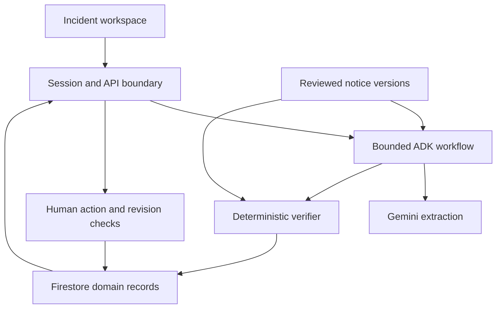

# BatchBeacon AI execution handoff

**Mode of this deliverable: PLANNING ONLY.** No application implementation, dependency installation, cloud provisioning, paid model call, deployment or submission occurred. The two originals are preserved unchanged. Actual document reviews and source checks are recorded in [PLAN_REVIEW](reviews/PLAN_REVIEW.md) and [SOURCES](SOURCES.md).

**Recommended execution:** one modular Python application serving the UI and API; one bounded Google ADK workflow with Gemini; deterministic identity/scope verification; Firestore for incident/result/action history; Cloud Run for the judge-facing service. Keep the distinguishing evidence → product → uncertainty recovery → human action → source-update journey central.

**Owner revision:** 2:40 core + 3:50 submission cut; one owner/Codex/one machine; A workflow accepted in principle with replacement visuals pending; both dashboards and a bounded operational learning loop required. The owner grants scoped cloud/public/repository execution and the recommended finite ₹6,000 budget. Read [OWNER_DECISIONS](OWNER_DECISIONS.md), [EXECUTION_POLICY](EXECUTION_POLICY.md), [OPERATIONS](OPERATIONS.md), [retail scope](../specs/retail-operations.md) and [INDEX](INDEX.md). Actual configuration, application work and native goal remain unverified.

## 1. Start here and document authority

The root and intended repository name are `batchbeacon-ai`; the product is **BatchBeacon AI**. The selected theme is Retail & Commerce. Do not restart ideation or rename it.

Read the [approved brief](../HACKATHON_BRIEF.md) for product authority and [master prompt](../HACKATHON_CODEX_MASTER_PROMPT.md) for operating rules. [MVP](../specs/mvp.md) defines implementation acceptance; [tasks](../specs/tasks.md) defines order/evidence; this file defines execution and gates. [SOURCES](SOURCES.md) records explicit conflicts and current facts. Preserve applicable actual system/global/parent/nested workspace instructions. The implementation invocation adopts the project-specific owner grants recorded in OWNER_DECISIONS; a copied generic policy cannot expand them. Actual client/account permissions and the remaining destructive/material-terms/final-submission gates still apply.

The first-session [kickoff](../prompts/01-codex-kickoff.md) reads both originals fully once, inspects the **real** workspace, and creates or conservatively updates concise `AGENTS.md` and `docs/STATE.md`. Neither file is pre-created by this planning package because doing so would invent machine state/instructions. Later sessions load bounded current state and task-relevant sections rather than reloading the entire archive.

## 2. Current constraints and explicit reconciliations

- **Verified cutoff:** 18 October 2026 at **23:59:00 IST** (`2026-10-18T18:29:00Z`), from the authenticated form X01. Recompute time remaining at launch and every milestone. No extension is assumed.
- **Video decision resolved by owner:** preserve a **160-second core** and **230-second submission cut** from the same footage. The owner explicitly approved 2:40 + 3:50 on 17 October (U01 / DEC-01), resolving the operating-contract exception. The source wording still conflicts; recheck the form and actual exports. Do not ask for the same duration decision again or edit either original.
- **Packaging now concrete:** use the official deck template; PDF up to 5 MB; description up to 1,024 characters; public GitHub and functional deployment links. Full section mapping is in SOURCES X02, not the brief's optional 7–8-slide outline.
- **Capacity and eligibility:** Rohit is the available human owner/reviewer, with Codex as primary executor on one machine. The four-person roster and eligibility are owner-attested (U14), not independently ID-verified. Personal timing belongs only in ignored local configuration. Final review of the concrete candidate and material terms remains separate.
- **G0 split is explicit:** G0-L admits safe local preparation; G0-X retains real model/cloud/database admission. Independent authorized backend/environment work may proceed while UI selection or external authority is pending. An unrun G0-X never becomes PASS.
- **Architecture invariants stay:** Gemini, a real bounded ADK workflow, Cloud Run, Firestore, two authorities/countries, one genuine update, uncertainty recovery, server-approved simulated actions and isolated guests remain P0. Direct SDK is diagnostic only; cached/fixture-only evidence cannot substitute for live AI.
- **Operational exclusions:** unfinished StackClimb Work Package Protocol and Multi-Work-Package Orchestration; extra lifecycle systems, runtime multi-agent swarm, Kubernetes, Temporal, arbitrary ingestion and production commerce actions.

See SOURCES DEC-01–14 for reasons and reconciliations. New P0-12/13 and OPS requirements are owner-authorized extensions, with explicit additional delivery risk. This plan is **ready for local kickoff**, not a READY TO SUBMIT decision.

## 3. Architecture recommendation

### One service, explicit boundaries

For an empty workspace, recommend **FastAPI + Jinja2 templates + small native JavaScript modules/CSS**, served together. This avoids a second runtime/build/deployment merely for a small incident workspace. Use Python pytest/httpx for domain/API checks and Python Playwright for real browser journeys. Pin actual compatible versions during M1; no version numbers or installed tool claims are invented here. If a compatible event-built frontend already exists, preserve it with a recorded reason instead of migrating it.

The browser never accesses Firestore or the model directly. One application contains source adapters, ADK/extraction, a pure domain verifier, an action service, evidence/history views, a scoped retail queue and the fixed guidance-candidate evaluator. The private technical dashboard uses native Cloud Monitoring/Logging IAM outside the guest UI; it does not require another public application service. Firestore persists domain state explicitly; do not assume it is an off-the-shelf persistent ADK session adapter. Reconstruct bounded agent context from domain records using the selected version's supported mechanism.

All backend nodes run in one Cloud Run service. The diagram expresses logical boundaries, not multiple services. Source publication is trusted backend/custodian work; guest source-update replay is incident-scoped.

| Boundary | Contract and reason |
| --- | --- |
| Source adapters | Fixed SFA/FSA URLs and versioned reviewed manifest. No arbitrary browser/URL agent. Preserve geography and identifier types. |
| AI | Multimodal source/label extraction, bounded targeted recapture and supported explanation. Gemini candidate is `gemini-3.8-flash`; account access/settings are a G0-X check. |
| Verifier | Pure typed rules; product identity before lot; unknown is not wildcard; all-candidate aggregation; no safety clearance claims. |
| Action service | Server-established demo actor and incident ownership; explicit confirmation; transactionally current source/observation/result revisions; logical-action deduplication and outcome reconciliation. |
| Persistence | Immutable notice/result versions plus server-only history/actions; active source epochs/currentness checked on every result read and approval. Real Firestore tests are mandatory. |
| Guest security | Short-lived same-origin server session; one synthetic shop per session; no client-controlled roles, public database rules or global-source write capability. Retail summaries/feedback/candidates/policies use the same ownership/expiry boundary. |
| Retail console | Bounded derived rows/counts, no model call or mutation on refresh; currentness precedes history/action display. Open the same A workbench. |
| Operational learning | Structured feedback, allowlisted guidance candidate, actual pure L01–L06 checks, explicit version-bound shop activation and monotonic rollback. No model training, arbitrary prompt runner or global policy mutation. |
| Technical operations | One private BatchBeacon Operations dashboard, cheap uptime and bounded alert/telemetry queries; actual source/model/verifier/guidance/release provenance. |
| Images | Short-lived private Cloud Storage for the sanitized bytes actually supplied to Gemini, with server-authorized references and expiry. Selected from the brief's permitted storage option to preserve reviewable image evidence after refresh. Include it in the concrete cloud/budget approval; memory-only local fallback cannot pass retained-image audit gates. |

### Technology choices and rejected complexity

The corpus is small: select eligible evidence by authority, jurisdiction, family/version and metadata, then pass bounded full notices. No vector database, reranker or GraphRAG is needed. Preserve citations/freshness/tenant boundaries regardless of retrieval method. A workflow composed of one bounded ADK agent plus deterministic functions suffices; separate development reviewers do not make the product a multi-agent application.

Use the Google Cloud endpoint supported by the verified account/runtime. U11 delegates selection: Mumbai `asia-south1` for compatible app/data/artifact resources and `global` for Gemini 3.8 Flash. Preserve an existing compatible immutable database location. Verify canonical SDK/environment settings at G0-X. Model processing is separate from resource placement; no India-only processing guarantee follows. OPERATIONS records the inspected event constraints and fallback rules.

Firebase/Cloud Firestore is the planned Firebase contribution. Explain its real role in the submission. A separate Firebase Auth/Hosting service is not silently added because the form lists Firebase; resolve an explicit contrary organizer instruction if one appears.

## 4. Prerequisites and local discovery

| Needed when | Requirement | Verification / safe fallback |
| --- | --- | --- |
| Launch | Actual folder with these files; functioning Codex client/session allowed to read it | Open the folder and run `codex`; inspect `codex --help`/`--version` if available. Official syntax is documented, owner-machine execution unverified. No special permission/model flag. |
| M0 | Git state/inherited instructions and writable intended files | Read before initialization/edits; preserve unrelated changes. If inside an unrelated parent repository, stop project mutation and ask for the intended isolated location. |
| M1 | Compatible Python environment and project-local dependency permission | Discover versions and manifests; use an isolated local environment and reviewed locked dependencies when authorized. If Python is unavailable, continue document/contract work and request the precise prerequisite once. |
| M1/M3 | Browser testing capability | Discover a real browser or compatible Playwright installation; renderer success alone is not E2E. A browser install needs the applicable local install permission. |
| G0-X | Actual Google project, billing/spend, runtime/build/deploy identities, region/endpoint, APIs, model quota, Firestore | Use supported keyless authentication; secure local setup; bounded authorized smoke checks. No inherited budget or project identity. |
| M2 public gate | Public deployment allowed by organization/project and owner; synthetic data and runtime budget controls | Private deployment can prove infrastructure if authorized; it does not close anonymous judge access. |
| M4/M5 | Actual reviewer/evidence custodian capacity; ability to export/record real artifacts | Real subagents only when available. Otherwise label role-based review; protect final-case custody and disclose limitations. |
| M5/M6 | Repository/publication authority, template copy, verified video exports, final approval | Prepare concrete artifacts first, then request only unresolved approvals. |

Docker, Node, Firebase CLI, Google helper CLI, Claude Code, MCP and extra agents are optional. The chosen UI does not require Node. A working browser and deployed integration checks are obligations even if the preferred tool is unavailable.

Use [local_preflight.py](../scripts/local_preflight.py) for read-only version/path/hash/Git discovery after inspecting it. It neither installs tools nor proves authentication. [configure_local.py](../scripts/configure_local.py) collects/validates irreducible non-secret settings into an ignored local file; it performs no cloud action and grants no authority. Both require **local verification**; package validation is not a test on the owner's machine.

## 5. Authority and approval points

This chat remains planning-only. When the owner invokes the kickoff in Codex, execute local implementation and the concrete project-specific grants U09–U12. Prepare/inspect the actual operation and verify its conditions; do not request already-given cloud, budget or repository permission again. No answer is inferred for an unrelated action.

| Operation | Gate / authority |
| --- | --- |
| Read workspace/docs and public sources | Read-only discovery; redact sensitive output. |
| Local plan/contracts/tests/code and provisional UI | Proceed when owner invokes local implementation in the intended workspace; protect unrelated work. This planning chat does not execute them. |
| Project-local dependencies/skills/browser binaries | Review manifests, installer/lifecycle behavior, license, source/version and actual client compatibility; install only within current authorized local scope. No bulk/global/trust override. |
| Local commits/worktrees | After workspace ownership and current local authority checks; stage intended safe files only. No reset/stash/cleanup of others' work. |
| Remote writes, repository creation/publication, push/merge | U12 authorizes ordinary in-scope work in `imrohitagrawal/batchbeacon-ai`; inspect/scan source/history/media and verify remote refs. No force push or expanded admin/purchase authority. |
| Paid model/evaluations/build/runtime/storage/monitoring | U09: ₹6,000 through 7 November 23:59 IST, exact pools and stop policy in OPERATIONS. Verify billing-currency rates and persistent admission; no coding-credit or paid-plan purchases selected. |
| Cloud resources/APIs/IAM | U10 authorizes the concrete minimal resource/identity setup in OPERATIONS in the existing dedicated project. Inspect actual bindings and use least-privilege keyless credentials; unrelated privilege expansion remains gated. |
| Public Cloud Run/access | U10 grants synthetic judge-app exposure after actual security/budget gates. Bucket, technical dashboard and global technical data remain private; no public object grant. |
| Real/private data transmission or real business actions | Excluded from P0; new explicit scoped authorization and revised safety/privacy plan would be required. |
| Source trust/manifest promotion | Named evidence custodian verifies evidence; backend-only update. A guest never approves source truth globally. |
| Final visual direction | The three directions have been presented; A is accepted in principle. The original visual treatment is rejected. Obtain owner approval of a materially improved high-fidelity A treatment before finalizing DESIGN. Independent backend/environment work continues. |
| Destructive cleanup/rollback with data loss | Dry-run inventory, exact ownership and applicable authorization; retain live judging/rollback assets. |
| Submission, acceptance of material terms | Concrete verified release + video exception if unresolved + explicit owner submission authority; retain platform confirmation. |

Ordinary billing alerts do not stop spending. Current Google service spend-cap budgets are an additional option with limited scope/delayed enforcement; verify support and approved values in [OPERATIONS](OPERATIONS.md). Use persistent request/token/cost reservations and circuit-breaking across instances, bounded model/tool/retry/job limits and small max-instance/concurrency settings. Reserve demonstration capacity. Missing billing data is unknown, not zero; even a closed model gate does not instantly stop all cloud/storage/build costs.

## 6. Deadline, ownership and dependency order

### Time calculation

At actual kickoff let `W = verified_cutoff - current_time` in hours. Revalidate X01 if it changed or the deadline has passed. Set the protected finalization reserve `R = max(4 hours, 0.25 × W)` when W is sufficient. The brief's 4–6 hours is a planning reference; compute the actual value from W0 instead of carrying forward an earlier window estimate. If W is shorter than the reserve or insufficient for the actual critical path, report NOT READY risk immediately; do not compress safety/eligibility by assertion.

Record exact kickoff `W0`, reserve `R` and the computed scope-freeze timestamp only in ignored `.local/run-policy.json`; public STATE contains the private-policy pointer and sanitized feasibility/freeze status. Do not automatically shrink the reserve as the clock advances. Set scope freeze at `cutoff - R`; target actual submission **one hour before** the official cutoff, leaving the last hour for verified upload/access recovery. That is an internal target, not another official deadline. Recalculate remaining capacity after discovery, the first hosted slice and a consequential blocker; moving freeze later or reducing the protected reserve needs an explicit recorded decision, not rolling recomputation. Human-dependent reviews, quota waits and unresolved decisions reduce usable capacity. Actual personal timing stays in private local configuration.

The inherited brief estimate is **32–48 person-hours / 14–22 critical-path elapsed hours**; the explicit task bands total approximately **31–66 person-hours**. These are historical feasibility inputs, not a forecast for Codex. The previous two-builder elapsed forecast is superseded by U03: **one human owner and one primary executor on one machine**. Optional verified coding/review agents may help, but no extra human builders, custodian or presenter are assumed. Follow the setup/finite-goal/resume sequence in EXECUTION_POLICY; derive a measured remaining-work forecast after real discovery and the first integrated slice. The newly required retailer console, learning loop and private dashboard add work beyond those historical bands. Completion is at material deadline risk. Preserve P0 and the fixed reserve rather than declaring gates compressed.

### Milestones and session boundaries

| Milestone | Owner / prerequisite | Bounded output and verification | Time/next boundary |
| --- | --- | --- | --- |
| M0 / G0-L | Integrator; owner-invoked local kickoff | Actual workspace/capabilities, authority/clock, source conflicts, concise AGENTS/STATE, task/evidence ownership. No invented installed tools. | Aim ≤45 min; same session into safe M1. |
| M1 Foundation | Codex integrator; Rohit for human source/design decisions; G0-L | Frozen interfaces, independently specified first-slice cases, reviewed SFA manifest and rules, replacement high-fidelity A treatment, admitted minimal dependencies/CI. Preserve full corpus/custody in T03b/T04b. | Front-load concrete source/design review and supported sign-in. Prepare/verify selected skills before use; final visual approval blocks only visual finalization. Verify native continuation before admitting a finite goal. |
| G0-X External admission | Authorized integrator/operator; concrete cloud/spend authority | Small real model call, real Firestore read/write/transaction under actual identity, minimal deploy proof, region/quota/cost/access facts. | Run as early as authority permits, in parallel with local work. Not a feature-complete slice. |
| M2 Early hosted slice | Codex integrator; source/contracts, G0-X and applicable exposure approval | One source + photo → Gemini through ADK → safe comparison → deliberately approved persistent simulated action → refresh. UI may be provisional. | Establish the G1 forecast from measured one-machine progress and the fixed reserve. The old two-builder elapsed target is superseded. Fresh checkpoint after the verified deployed slice. |
| M3 Complete P0 | Codex integrator with only verified isolated helper capacity; M2 | Second authority, recapture, version invalidation, currentness/idempotency/isolation, approved replacement UI, scoped retail console, guidance learning/rollback, private operations and development evals; six flows. | May continue in an admitted finite native goal. Finish scope by `cutoff - R`; drop P1 first. |
| M4 Independent readiness | Fresh reviewer/custodian; frozen candidate and evidence | Requirements-first product/security/QA/AI/hosted review; final-case execution with custody; one consolidated correction list and release decision. | Start within reserve; budget ~1–2 h plus critical fixes, adjust explicitly. Fresh review context. |
| M5 Package candidate | Presenter/integrator; verified core and applicable approvals | Prescribed deck PDF, actual video, README/guide, source/eval manifests, exact URLs/revisions/limits, secret/media scan. | Protect remaining reserve; same session for coherent corrections. No feature expansion. |
| M6 Submit and close | Owner/captain + integrator; final approval | Authorized submission; receipt; exact release tag/links; resource/access owner through judging; durable state/handoff. | Internal target D−1 h. No invented receipt or unattended maintenance claim. |

Critical path: independently reviewed first SFA source/contract → real extraction → deterministic comparison → Firestore action/currentness → early hosted slice → second authority/recapture/update plus bounded retail/learning/operations → frozen real-model/browser verification → artifact/access checks → authorized submission. T03a/T04a/T05a provide bounded first-slice checkpoints; T03b/T04b retain full custody/two-authority obligations. Source/fixture custody and replacement visual-treatment work can proceed independently against stable contracts within verified single-machine capacity. Action and UI adapters may start against T05a while real extraction is built; sign-off waits for actual integration, so partial tasks are never marked complete. Only the integrator changes shared contracts/lockfiles and deploys. Parallel writers require distinct branches/worktrees and non-overlapping paths; otherwise execute sequentially. Paid quota and cloud fixtures are shared capacity constraints. After UI selection, visual implementation can proceed against frozen interfaces while update/backend work continues; all-flow sign-off waits for integration. A presenter may prepare static template/storyboard/guide content before freeze, but final screenshots, measurements, captures and exports must bind to the frozen tested candidate.

See [EXECUTION_POLICY](EXECUTION_POLICY.md) for mode transitions, single-machine ownership, the continuation canary, private run record, permitted queue and stop conditions. A checkpoint is not a process supervisor.

## 7. Verification gates and fallback behavior

| Gate | Required evidence | If blocked or failed |
| --- | --- | --- |
| G0-L | Correct intended path/instructions, known local state, accepted product, verified clock/source register, local authority and capability gaps | Preserve files; resolve wrong path/instructions before mutations. Continue permitted document work. |
| G0-X | Actual approved project/budget/location, real model/Firestore/identity/minimal deployment checks | Local work continues; provider/permission issue stays BLOCKED. Two unchanged failures trigger diagnosis/bounded experiment, not retry loops. |
| G1 / M2 | Real source/photo/ADK/verifier/action through deployed application and persistence | Simplify shell/tool flow, not P0 semantics. A health endpoint/provider script/fake cannot pass. |
| G2 / M3 | Second authority, useful recapture, genuine update with all dependent invalidation, implemented retail/learning/operations and viable baseline plan | Drop all P1/tool embellishments. No one-country or fixture-only substitute. If core proof remains impossible, report NOT READY and specific owner decision. |
| G3 / M4 | Full P0 evidence, frozen development/final validation, no observed critical safety/authorization failures, six hosted flows, no unresolved blocking review findings | Fix critical defects and rerun affected checks. Final-set exposure is disclosed; replacement custody required for a renewed held-out claim. |
| G4 / M5–M6 | Correct template/size/fields/duration decision, matching source/app/video/deck, public access, final authority and successful confirmation | Only packaging/access fixes. No new product or unapproved submission. |
| G5 / evaluation | Owned functioning endpoint/dependencies, retained known-good revision, documented monitoring and repair access | Restore the same URL with critical repairs; record actual actions. Do not promise unattended monitoring without a real authorized job. |

Use seven evidence layers: unit, API/integration, fake/emulator, real service, real model, real-server browser and deployed judge path. The [MVP test registry](../specs/mvp.md#8-tests-evaluations-and-evidence-registry) specifies their scope. Always include run configuration and denominators; distinguish PASS/FAIL/NOT RUN/BLOCKED/NOT APPLICABLE. Baseline/human-study absence can be a disclosed nonblocking limitation with narrower claims; safety, required Google runtime, 10/12 useful decisions, genuine source update and executed final validation cannot be quietly waived.

### Safe fallbacks

1. Use a labelled functional provisional shell while replacement visual approval is pending. The rejected original diagrams are not a final-quality fallback; meet the same visual acceptance with admitted skills or native methods.
2. Use built-in instructions and standard tests when optional skills cannot be admitted quickly.
3. Use allowlisted reviewed historical snapshots when live fetching is unavailable, labelled as historical. If required evidence/rights cannot be established, that source stays review-only and its P0 gate remains open.
4. Use a verified supported Google model/ADK configuration after recording compatibility and comparing required cases; no silent model/architecture downgrade.
5. A private hosted smoke check may proceed within specific authority while public exposure is pending, but does not satisfy anonymous judge access.
6. Replay a previously verified result only with an explicit replay/cache label; it never closes real-AI or live-service gates.
7. If a recall-specific core gate cannot be met, make a transparent NOT READY decision. The historical FormBridge contingency needs a separate owner-approved change and feasible remaining time; it is not an operational fallback in this package.

## 8. Exact operational runbook

All terminal examples below run in the **actual `batchbeacon-ai` root**. They are instructions for local verification, not claims of successful execution here. Scripts exist in this package before they are referenced. Prompts in this table are complete files; commands generated later must be recorded only after the relevant script/module exists.

| Stage / surface | Exact command or instruction | Inputs / expected result / failure / session |
| --- | --- | --- |
| Open, terminal | `codex` | Run after opening the intended root. Existing supported sign-in/trust flow if needed. If missing, report it and use official installation guidance under actual machine authority; this handoff does not install it. |
| Kickoff, Codex | `Read prompts/01-codex-kickoff.md and execute it using the approvals in docs/OWNER_DECISIONS.md. Continue the authorized dependency-ready queue; preserve the remaining gates.` | Reads both originals + plan; inspects actual workspace; conservative AGENTS/STATE; begins local foundation. Same session while coherent. |
| Mode selection, Codex | `/plan` for read-only analysis; normal implementation mode for authorized writes; `/permissions` to inspect the actual access mode | Verify installed support. Do not create AGENTS/STATE while the active native Plan mode prohibits edits. Prefer scoped automatic approval review where available; no silent Full Access change. |
| Finite goal, Codex | After verified admission, enter `/goal` and instruct: `Read prompts/overnight-goal.md and execute the permitted queue in the actual run record.` | Actual native support, private finite policy, applicable authority/budget and useful continuation canary are required. No unattended run is started by this table. |
| Discovery, terminal/Codex | `python3 scripts/local_preflight.py` | Read script first. Prints read-only capability/input/Git observations; no login/network/cloud proof. If Python missing, perform equivalent native read-only discovery and record the gap. |
| Settings, terminal | `python3 scripts/configure_local.py` | Optional attended helper after discovery; prompts for non-secret settings only. For autonomous setup, derive already-approved/discoverable values and create the same validated ignored schema directly, then use --check. Do not re-ask budget/region decisions or block on interactive input. No cloud calls; existing files preserved. |
| Validate settings, terminal | `python3 scripts/configure_local.py --check` | Validates existing local settings only. Missing/invalid fields block affected external work; no placeholder project IDs. |
| Slice, Codex | `Read prompts/02-first-slice.md and execute the next authorized slice tasks against docs/STATE.md.` | Real G0-X/M2 only after specific authority. Optional UI choice can remain pending. Create and verify exact local/cloud commands against installed versions. Checkpoint after G1. |
| P0 completion, Codex | `Read prompts/03-complete-p0.md and complete the next dependency-ready P0 tasks.` | Integrate current contracts; no new ideation/frameworks. Stop only affected blocked paths; one evidence-bound checkpoint per coherent result. |
| Independent review, fresh Codex context | `Read prompts/04-independent-review.md and perform the requirements-first M4 review.` | Read actual source/spec/evidence before completion narratives. No unsolicited code edits/paid calls. Record actual reviewer IDs or role-based limitation. |
| Release, Codex | `Read prompts/05-release-and-submission.md and prepare the concrete M5 release package; execute M6 only within explicit current authorization.` | Template, actual artifacts, field sizes, video decision, fresh access checks and final receipt gate. |
| Resume, new Codex session | `Read prompts/resume.md, reconcile actual workspace state, and continue the next authorized bounded task.` | STATE is a starting hypothesis; actual Git/resources/evidence win. Revalidate changed permissions/clock. |
| Handoff, any Codex session | `Read prompts/handoff.md and create a verified checkpoint and restart instruction.` | Preserve unfinished work; no broad cleanup or forced sync. LOCAL CHECKPOINT ONLY if remote not authorized/available. |

### Commands that M1 must materialize

M1 creates project-local manifests/lockfiles and small idempotent bootstrap/check/start scripts **after** discovering the real Python/package/client versions. Expected command families include a locked install, unit/API checks, browser runner, development evaluation runner and authenticated cloud probe/deploy. Do not write fictional exact package versions or gcloud flags in advance. Resolve IDs through local discovery/configuration; use secure auth, never keys in command strings. Record each exact command, location, required gate, expected assertion, failure diagnosis and executed result in `docs/STATE.md`/evidence once its target exists.

No `curl | shell`, global package install, fabricated project ID, universal `--yes`, trust bypass or automatic cloud teardown belongs in bootstrap. Inspect lifecycle scripts. Paid/evaluation/deployment commands must be explicitly gated and fail closed when their configured authority/budget is absent. Two unchanged failures require a diagnosis; a new attempt must have new evidence or a bounded changed hypothesis.

## 9. AGENTS, STATE and session closeout contract

`AGENTS.md` should stay roughly 60–100 lines or fewer. After actual inspection, include canonical pointers including INDEX/EXECUTION_POLICY, immutable product/safety rules, authority boundaries, the UI-selection gate, source/evidence truthfulness, exact **verified** local commands, integrator/parallel-writer rules and closeout. Preserve unrelated instructions; do not paste this handoff/master wholesale or add CLAUDE.md unless that client is actually used.

`docs/STATE.md` should normally stay under 120 lines and include: capture time; objective/current milestone; actual branch/commit/tree and remote status; capability/install/auth facts and limitations; approvals with scope/expiry/source; UI choice or pending state; completed acceptance IDs linked to evidence; failures/NOT RUN/stale evidence; unresolved decisions; current model/prompt/source/guidance/config versions; permitted task queue, private `.local/run-policy.json` pointer and redacted admission status only; spend uncertainty; next dependency-ready bounded task and exact prompt. Actual private run times, personal availability and local process/session identifiers must not enter public STATE or evidence. Archive detailed historical logs outside the bootstrap summary.

Checkpoint after verified work and before necessary context/tool-discovery restarts. Fresh contexts are useful at M2 completion, M4 role change and degraded context, not after every command. Resume independently verifies actual workspace/resources and applies the owner-recorded project grants adopted by kickoff; a generic copied handoff cannot expand them. Verify private run policy and skill discovery anew when their environment changes.

Inspect/stage only intended files, scan secrets/private material, commit when authorized and push only with remote authority. Verify the remote ref instead of assuming a successful command synchronized everything. Do not force-push/reset/stash unrelated changes. An unmerged branch can be a valid checkpoint. Avoid endless closeout commits that only update their own hashes.

Track owned worktrees, temp paths, environments, servers, browser contexts, containers, cloud fixtures, deployments and temporary grants by exact identity, purpose, retention and cleanup trigger. Clean only identified inactive task-owned resources with applicable authority after dry-run/revalidation. Keep useful environments, judge deployments, rollback images, evidence and unmerged work. Never sweep `/tmp`, broadly prune Docker, kill by port alone or delete cloud resources because a session ended.

## 10. Submission proof and roadmap

Keep the full official rubric: Technical Merit/GenAI 40%; Problem Alignment/Impact 25%; Innovation/Creativity 25%; UX/Solution Design 10%. The three supplementary lenses remain differentiation, verifiable global value with JAPAC relevance, and deadline-adjusted delivery; they do not add weights.

| Criterion | Concrete proof |
| --- | --- |
| Technical 40% | Real Google workflow, typed deterministic comparison, safe persistent actions, version/currentness and actual eval/browser evidence. |
| Impact 25% | Specific retail task, two-country portability with disclosed coverage, measured time/error comparison where available. No invented adoption/health outcome. |
| Innovation 25% | Competitor-aware combined identity/uncertainty/version workflow and competent same-model comparison; missing comparison narrows claims. |
| UX 10% | Approved coherent workbench/retail-console design, six usable journeys, evidence/uncertainty visible, safe guest access and accessibility checks. |

The 160-second core allocates: 0–15 problem/scope; 15–45 match/evidence; 45–65 same-lot wrong identity; 65–95 recapture; 95–125 genuine update; 125–145 human action/persistence; 145–160 measured proof/limits. The approved 230-second submission cut extends the same release: 160–180 seconds retailer queue/renewed review; 180–210 seconds the actual guidance feedback/evaluation/activation/effect/rollback; 210–225 seconds private operations and measured evaluation/architecture proof; 225–230 seconds limits/links. If a stage takes longer, show honest edited footage and link its persisted evidence; no fabricated instant execution. These are storyboard allocations, not measured exports. U01 closes the owner duration choice; DEC-01 preserves the source conflict. Measure the exported duration; never rely on the script's word count.

At M5 build an honest capability matrix (`LIVE VERIFIED`, `LOCAL ONLY`, `SIMULATED`, `INCOMPLETE`, `PLANNED`) and bind each material UI/deck/video/form claim to evidence. Source, images, model/cache/replay and action simulation labels appear at the point of use.

Roadmap stages to create in `docs/ROADMAP.md`: **B0** verified supported-corpus prototype; **B1** validated user workflow/export/language or linked multinational incident with measured benefit; **B2** approved authority-specific continuous-ingestion/integration adapters with privacy/operational controls; **B3** scalable governed paid operations with validated monitoring, entity resolution and regional processing. Promotion requires real user/evidence/safety/operational proof, not calendar promises. P1/P2 do not enter the current critical path.

Release statuses: **READY TO SUBMIT** only with all mandatory/P0 gates evidenced; **CONDITIONAL** only for explicitly accepted nonblocking limitations; **NOT READY** for any unresolved mandatory/core/safety/real-AI/access/submission dependency. Final submission is complete only after observed platform confirmation. Assign maintenance ownership through the funded 7 November 2026, 23:59 IST boundary. Flag later organizer obligations early for a new finite funded decision; no automatic spend extension or shutdown at upload.
