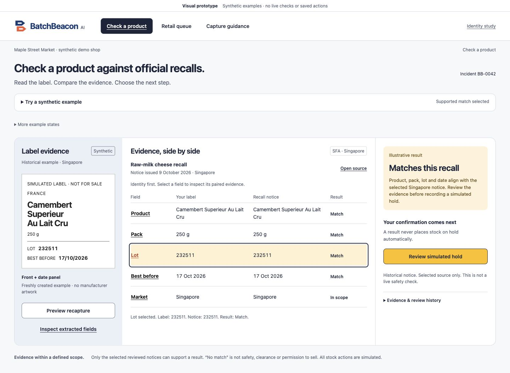
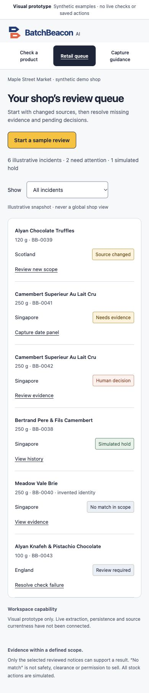
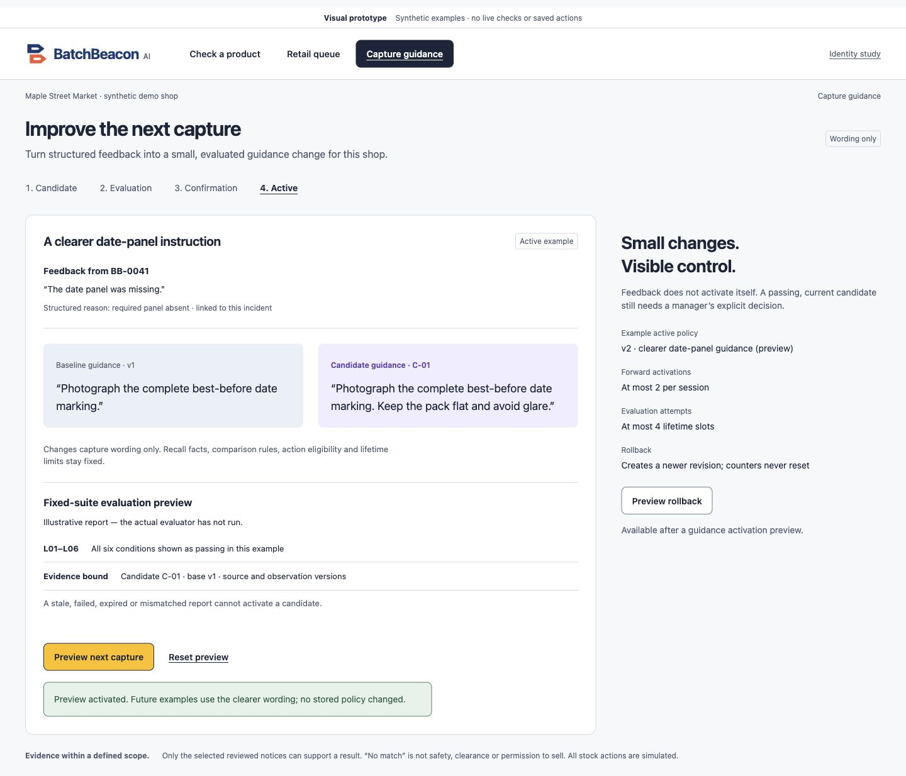
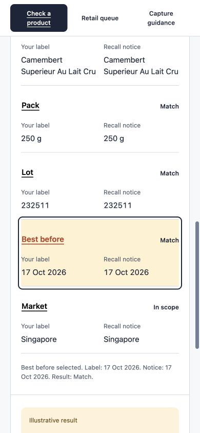

# BatchBeacon AI — product showcase and media provenance

**Try the working public application:** [batchbeacon.stackclimb.com](https://batchbeacon.stackclimb.com)

**Watch the submitted real-system journey:** [3:40 YouTube demo](https://youtu.be/IpY2_GeR4Ic)

**Submission and release truth:** [STATE](STATE.md) · [judge guide](submission/judge-guide.md) · [verified application architecture](submission/architecture.md)

## What BatchBeacon does

An individual retail worker faces a practical gap: a notice describes affected products and lots, while the person holding a package must check the actual identity, batch, dates and country conditions before acting. BatchBeacon AI joins those two kinds of evidence in a reviewable workflow. The working demonstration uses a **synthetic label** and **one reviewed historical Singapore Food Agency (SFA) recall notice**. A bounded **Google ADK + Gemini** extraction proposes typed label fields. **Server-side rules**, not the model, check identity before lot/date and jurisdiction. A human explicitly confirms a **simulated hold**; **Firestore** retains the decision for the same expiring guest shop after refresh.

### Media provenance — read before reusing images

| Media | Origin | Valid representation |
| --- | --- | --- |
| [Public submitted video](https://youtu.be/IpY2_GeR4Ic) | Real accepted custom-domain release, recorded and checked for the final hackathon package | **Actual deployed application**: live Gemini extraction, source-bound checks, explicit simulated hold and persisted queue |
| Four images below (`docs/ui/final-candidate/`) | Earlier reviewed **UI prototype / visual candidate** captured during product design | Interface illustration, **not** proof of deployed model operations or a pixel-identical rendering of current hosted release |
| [UI release notes](evidence/M4-ui-domain-correction.md) | Dated browser, hosting, asset and usability verification records | Describes what changed between earlier captures and verified live release |
| [Exact release source](https://github.com/imrohitagrawal/batchbeacon-ai/tree/04546e0944adfed521efcd3b20e7fa7387c39101) | Accepted Cloud Run application revision `04546e09` | Deployed source provenance, **not** a screenshot |

The real hosted screenshots used in the organizer presentation were privacy-reviewed and retained with private publishing receipts. They have **not** been committed as separate public PNG/JPEG files, so it would be inaccurate to relabel the earlier repo-design screenshots as those exact live captures. Add newly cleared hosted screenshots here only when the original sanitized pixels and their accepted deployment provenance are available.

## Reviewed interface images

### Evidence-focused investigation workbench

*Reviewed visual candidate. See the submitted video for actual accepted-deployment Gemini and decision evidence.*

### Retail operations queue on mobile

*Shows the layout concept; current guest-owned persistence was separately verified with the live application.*

### Guidance lifecycle and confirmation

*The deployed service separately verified fixed evaluation, explicit activation and rollback; this image alone is not that test evidence.*

### Mobile label evidence panel

*Reviewed pre-release UI capture. Source interpretation and safe actions are governed by the server and human confirmation.*

## Technology and risk architecture

| Layer | Confirmed implementation | Why judges should care |
| --- | --- | --- |
| User experience | Native responsive HTML/CSS/JavaScript and a guided workflow | Inspectable physical-label evidence and understandable decision stages |
| API / policy | Python 3.12, FastAPI, Pydantic | Typed input/output boundaries, scoped authorization and reviewable deterministic checks |
| AI | Gemini 3.8 Flash through Vertex AI and one bounded Google ADK `LlmAgent` / `Runner` workflow | Multimodal field extraction kept separate from final rule decisions |
| Durable state | Firestore, server-enforced ownership and transactional admission | Saved queue/actions, usage limits, idempotent operations and guest isolation |
| Retained media | Private Google Cloud Storage | Evidence bytes preserved behind server ownership checks |
| Hosting / edge | Google Cloud Run + fixed-upstream Cloudflare Worker | Public judge journey with separately secured backend and custom hostname |
| Operations | Cloud Monitoring/Logging, private technical dashboard and policy setup | Deployment/cost oversight without exposing privileged controls to guest users |
| Engineering | Pinned uv/Python dependencies, Ruff, pytest, Playwright, GitHub Actions, Cloud Build + Artifact Registry | Repeatable local checks, CI and digest-bound deployment evidence |

Use [Google technology evidence](submission/google-technology-evidence.md) for exact usage and exclusions. Do **not** describe this release as a multi-agent swarm, RAG service, continuous recall crawler, certified food-safety engine or an enterprise SLA.

## Distinctive design

**Package → extract → inspect → verify → confirm → retain.** Product identity must agree before any apparent lot overlap matters; missing/contradictory evidence stays in review. The AI can read and propose, but neither infer safety nor authorize inventory. Controlled capture-guidance changes are evaluated and then explicitly activated or rolled back at new revisions; they cannot change source facts or verifier rules.

The demonstrable value is integrated evidence and accountability. Competitor feature exclusivity, model accuracy, retail time savings, consumer adoption, safety improvements and cost reduction are **not** independently established. See [competitive review](submission/competitive-positioning.md) and [approved boundaries](submission/release-scope.md).

## Future scope — not shipped

The proposed Consumer Recall Explorer would help citizens discover source-linked notices across countries with product/brand, date, hazard and batch filters. Separate work is required for licensed/reviewed notice imagery, trustworthy candidate visual search, persistent retailer Google/email accounts, live authority updates and permissioned producer/regulator analysis. All would retain original jurisdictions, event de-duplication, source versions and human validation. See [roadmap](ROADMAP.md).

## Public package

- **Hackathon:** Singapore AI Builder Cup 2026; Retail & Commerce
- **Team:** Bugging Debuggers; Rohit Agrawal, Aayushi Priya, Niharika Aggarwal, Priyanka Shelke
- **Submission:** organizer dashboard confirmed submission before the recorded deadline; the final PDF receipt is private ([redacted status](STATE.md#final-submission))
- **Video:** https://youtu.be/IpY2_GeR4Ic
- **Repository:** https://github.com/imrohitagrawal/batchbeacon-ai
- **Application:** https://batchbeacon.stackclimb.com

No real retail stock or public-safety permission is created by this demonstration.
