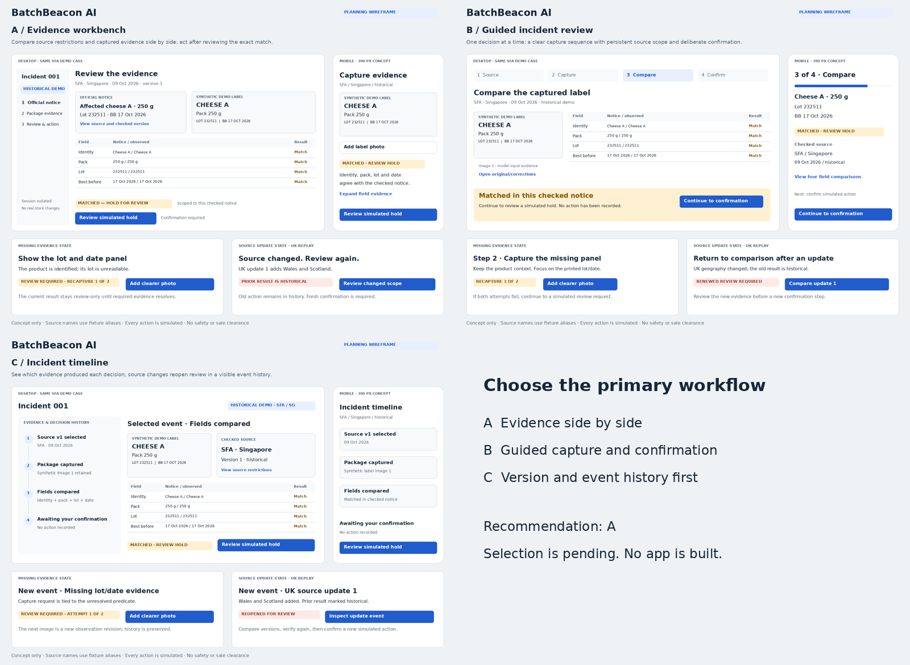
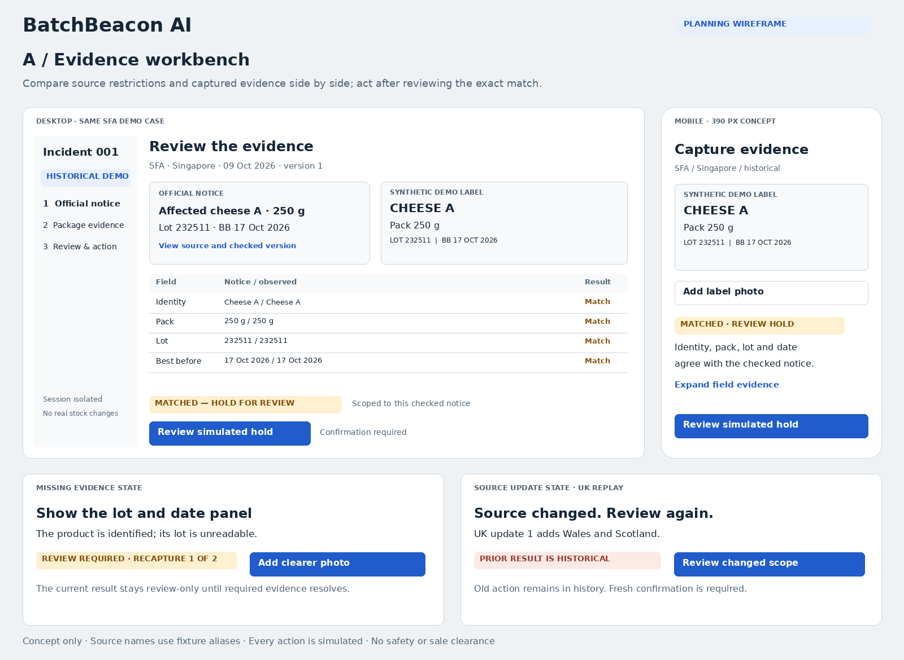
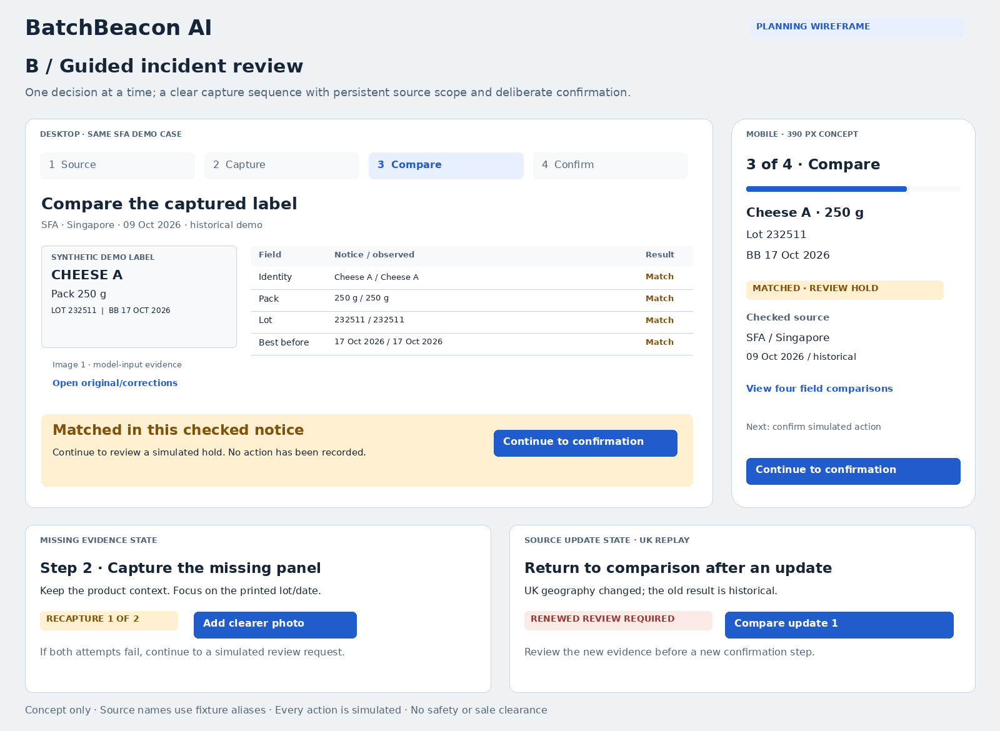
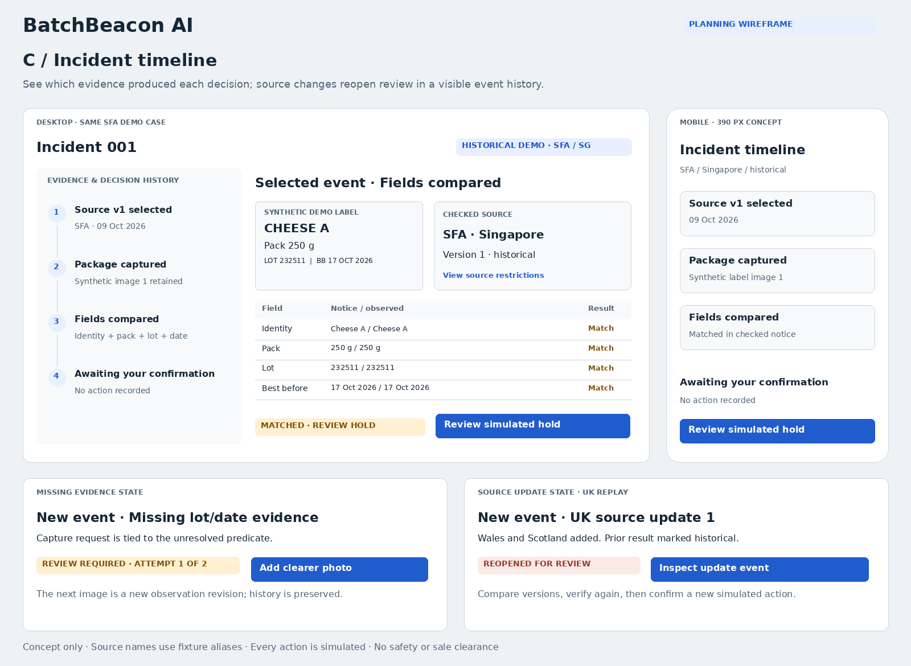

# Three BatchBeacon AI UI directions

**Owner update U02:** A’s evidence-workbench direction is accepted in principle. The owner rejects the existing visual treatment as unsuitable for final enterprise UI. These are historical planning wireframes, not the interface to reproduce or an approved visual design. All three show the same scoped SFA example, a mobile capture/review view, a missing-panel recapture and a separate UK source-update state. The differences are hierarchy and interaction, not color palettes.

**Recommendation: A, Evidence workbench.** It puts the product photograph, checked source and exact predicates together, making the approved differentiator quick to understand and inspect. The three options remain as the selection record. Do not ask the owner to choose A/B/C again. Present a materially improved high-fidelity treatment of A and obtain approval before finalizing `DESIGN.md` or visual implementation. Independent contracts, backend and authorized environment work continue while that treatment is pending. A reversible functional shell remains labelled provisional.

**Archived overview — its embedded selection request is superseded.** The image below retains the original “Choose the primary workflow” and “Selection is pending” wording as a historical record. Those words are not an active owner question: U02 closes the A/B/C choice in principle. Only approval of the replacement high-fidelity workbench and retailer-console treatment remains pending. Preserve these original concept files; use the current owner decision and this document when continuing implementation or presenting the next design review.

## Comparison and implementation implications

These relative cost estimates are design judgments, not measured implementation times. All directions fit the selected single-service UI/API architecture and all must meet the same P0 acceptance.

| Direction | Main hierarchy and key interaction | Best fit / tradeoff | Accessibility and cost implications |
| --- | --- | --- | --- |
| **A — Evidence workbench** | Notice and photograph sit side by side above a predicate grid. The user opens a result-bound confirmation only after seeing the comparison. Recapture names the missing panel; an update replaces current eligibility with renewed review. | Best immediate judge/user proof of identity-before-lot and scoped evidence. The desktop grid needs a deliberate stacked mobile adaptation. | Semantic comparison table on desktop; labelled field cards on mobile; logical source → capture → evidence → action focus order. Lowest additional navigation cost; recommended baseline. |
| **B — Guided incident review** | Source → capture → comparison → confirmation, one active step at a time. Scope remains visible; missing evidence returns to capture, while an update returns to comparison with history preserved. | Clearest first use and phone capture. More navigation can hide evidence if the persistent context and “view comparisons” affordances are weak. | Step list with current-step semantics and focus movement to the new heading; avoid losing entered/captured data on back navigation. Moderate extra navigation/state work. |
| **C — Incident timeline** | Evidence and decision events are primary navigation; selecting an event opens the exact source, observation and comparison. An update adds an event and reopens review. | Strongest manager explanation of why decisions changed. A first-time retail worker may need more guidance to find the next action. | Ordered semantic event list, current-event labels and a stable action region; keyboard selection cannot depend on color or motion. Moderate extra history-selection/currentness presentation work. |

## A — Evidence workbench

Editable exact wireframe: [direction-a-evidence-workbench.svg](ui/direction-a-evidence-workbench.svg).

The primary screen shows the checked historical notice, a retained synthetic model-input image, the field comparisons and a review action. The action opens a confirmation bound to the current result; this preview is not the confirmation itself. The mobile version keeps capture simple, makes field evidence expandable and preserves the source scope. A stale or unavailable result cannot leave an old hold control active.

## B — Guided incident review

Editable exact wireframe: [direction-b-guided-review.svg](ui/direction-b-guided-review.svg).

The active comparison step retains source and capture context, then asks the user to continue to confirmation. Recapture and updates move to the relevant step with a visible reason. Step movement never resets lifetime recapture counts, erases evidence or re-enables a stale action. A failed/exhausted capture still permits the supported simulated review-request path.

## C — Incident timeline

Editable exact wireframe: [direction-c-incident-timeline.svg](ui/direction-c-incident-timeline.svg).

Source, capture, comparison and action events explain the current decision. Selecting historical events cannot make them current or enable their old approvals. The current result and next permissible human action stay clear. A UK update is a separate incident's source event, never evidence of a Singapore/UK shared outbreak.

## Shared requirements and implementation gate

- Preserve original P0-01–11/F1–F4 plus owner-added P0-12/13/F5/F6. The original three sheets illustrate only the core workbench; they do not depict or approve the new retail console. Cover all essential states: empty, loading, matched, scoped negative, missing evidence, exhausted recapture, invalid input, unavailable model/source, rate/budget denial, session/permission denial, stale/cached/replay and recorded simulated action. These sheets illustrate selected states; they are not a complete tested state catalogue.
- The scoped negative says **“Not listed in these checked notices”** with the exact coverage and unresolved limitations. Never use “safe,” “all clear,” sale-release controls or color alone to imply reassurance.
- Human confirmation shows the current source/result/observation revision and chosen simulated action. An already-recorded action shows its existing record; a retry does not create another action. Review requests remain available for a current review-required result even when a simulated hold is ineligible.
- The source is historical by default. `LIVE_REFRESHED`, cache and replay labels require their actual evidence. Technical trace/cost/model proof belongs in a secondary view, not the primary retail flow.
- Use semantic labels, visible keyboard focus, status/error announcements, meaningful image alternatives, sufficient contrast, 200% zoom checks, 390 px layouts and reduced-motion behavior. The wireframe inspection does not establish WCAG conformance; T17/T22 require running-UI checks.
- Typography, spacing and the neutral blue/amber visual treatment are provisional. Keep action, uncertainty and historical states distinguishable. Impeccable and applicable Emil guidance remain preferred only after the admission checks in [TOOLING](TOOLING.md); neither is claimed installed or applied here.

### Evidence honesty in these previews

“Cheese A” is a **planning fixture alias**, not an asserted source product name. The inherited lot/date/pack example comes from brief S08; T04 must use the fully reviewed real product identity in source manifests and label the synthetic package fixture. The preview does not prove extraction, a source review, an actual match, a stored image or an action. All imagery was drawn as exact diagram shapes/text for this handoff; no photograph was generated or represented as a real product.

The UK update cards illustrate brief S09/S10's geography change to Wales/Scotland. They do not show the original out-of-scope result as a clean negative. The original UK scene remains historical/review-only until the new in-scope evidence is verified.

After replacement-treatment approval, record the approved visual treatment, preserved A workflow, accepted modifications and exact scope of approval in actual `DESIGN.md`/`docs/DECISIONS.md` and STATE. U02 is workflow agreement, not approval of the old palette, boxes or typography.

## Replacement treatment and quality gate

The old planning-sheet composition has weak hierarchy, repetitive nested boxes, undersized evidence and slash-joined notice/observed values. Replace that treatment. Recommend an evidence-led workbench with a compact incident header, large readable package evidence, distinct **Field / Checked notice / Package evidence / Result** columns, one coherent decision region, inline recapture and contextual secondary provenance/history. Keep critical match evidence on the main surface.

Pattern references: [Carbon tables](https://carbondesignsystem.com/components/data-table/usage/), [Cloudscape contextual views](https://cloudscape.design/patterns/resource-management/view/split-view/), [GOV.UK check answers](https://design-system.service.gov.uk/patterns/check-answers/). Their application here is a design judgment, not measured user validation.

Before finalizing the visual design, present one coherent high-fidelity approval set: desktop A workbench and retailer queue; phone capture/review and narrow queue; feedback/candidate comparison, clearly labelled illustrative evaluation-result, activation and rollback states. Actual executed evaluation and persisted effect/rollback are later T35/F6 evidence, never claims made by a design mockup. Use realistic labelled BatchBeacon fixture content. Show uncertainty, recapture and source-change behavior, with readable identifiers and restrained semantic color. Review typography, density, spacing, alignment, evidence scale, controls and state hierarchy as a coherent system. Owner approval must refer to these artifacts.

Then verify the running selected UI: keyboard/focus/status behavior, contrast, zoom, 390 px layout, capture/upload on an actual available phone, preserved evidence on retry, stale-action denial and deliberately labelled simulated confirmation. Screenshots must identify the actual revision; missing device/browser capability remains unverified. Skills and screenshots do not substitute for these checks.

Complete TOOLING SK-10–SK-30 (or record native fallback) before T06 relies on skills; record actual SK-40 application evidence. Impeccable remains the primary proposed design process, with selected Emil guidance for interaction/mobile craft after admission. The owner has confirmed Emil Kowalski’s identity. Neither has been installed/applied in this planning revision. Retain FastAPI/Jinja/native JS by default: these layout/craft improvements do not require React. A React/TypeScript/Vite static build served by the same FastAPI service is only an evaluated alternative if the actual workspace, component needs and deadline justify its extra build/dependency cost. No stack change is selected in this planning revision. Native methods may replace unavailable skills, but must meet this same quality bar; the rejected diagrams are not the final fallback.
