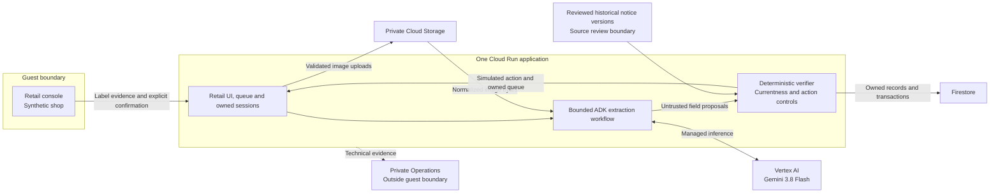
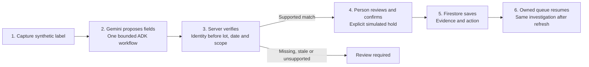

# Deployed architecture and journey

The accepted demonstration runs one Cloud Run application. Model proposals do not
authorize actions; deterministic server checks and explicit human confirmation do.
The diagram describes the delivered historical-source scope. Consumer discovery
and automated source-image ingestion remain in the [future roadmap](consumer-recall-explorer-roadmap.md).

Private Operations contains verified resource/monitoring-policy subsets. Full
application telemetry and alert firing/closure are not claimed. See [release scope](release-scope.md).
