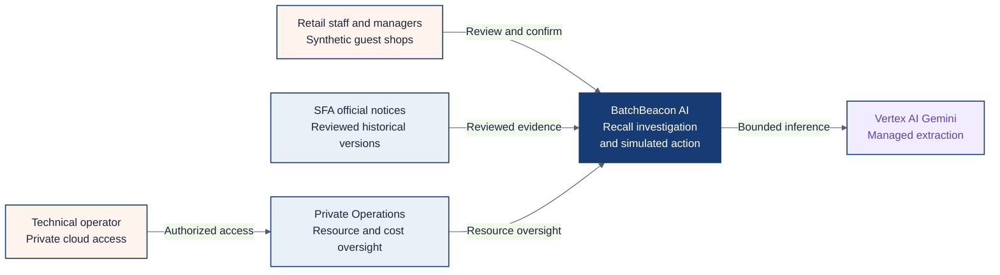
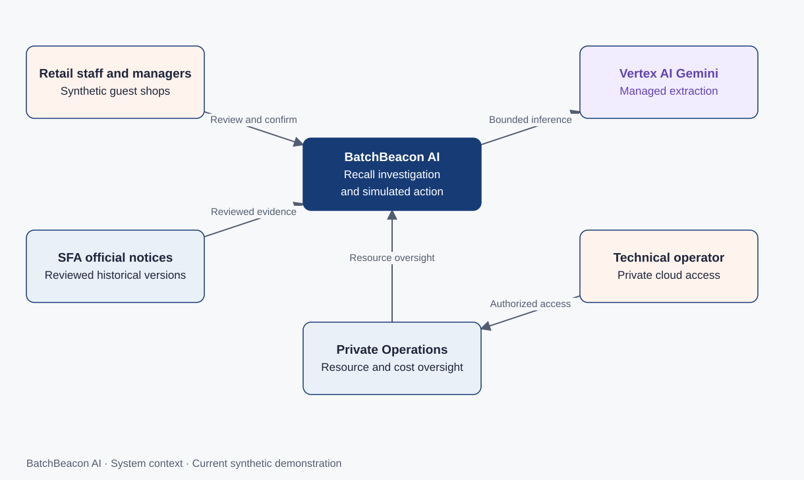
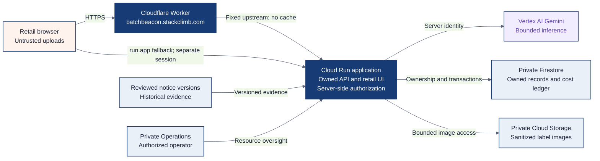

# Architecture and decisions

Last reviewed: 2026-10-18. [Accepted release and current limitations](../STATE.md).

BatchBeacon connects the label in hand to the conditions in selected official recall
evidence. AI proposes fields; server rules verify them; a person confirms a simulated
action. That separation makes the saved investigation reviewable.

These C4-style views move from people and external systems to running services and
key components. Mermaid is the editable source; each view also has an original
static SVG with descriptive text. This is not a complete four-level C4 code model.
Google/email accounts, consumer discovery and notice-image extraction are future
scope: [roadmap](../ROADMAP.md), [consumer proposal](consumer-recall-explorer-roadmap.md).

## System context

Retail staff and demo managers use BatchBeacon to investigate selected historical recall evidence. Official notices remain external evidence, and technical operators use a separate private surface.

[Editable Mermaid](context.mmd) · [Static SVG](diagrams/context.svg)

## Containers and deployment

A container here means a separately running application or data service. The browser reaches the dedicated Worker, which forwards only to the existing Cloud Run application. The original public run.app fallback stays available; server authorization therefore protects both paths.

[Editable Mermaid](architecture.mmd) · [Static SVG](diagrams/architecture.svg)

## Cloud Run components and external persistence

Firestore is an external service; confirmation checks run in the application and require an explicit human decision. This hand-authored view is a point-in-time snapshot, checked against the accepted release linked in STATE. It follows the request boundary, paid admission, model workflow, verifier and confirmation code. It is not generated code-level coverage.

```mermaid
%%{init: {"theme":"base","themeVariables":{"primaryColor":"#EAF0F8","primaryTextColor":"#1E253B","primaryBorderColor":"#173B75","lineColor":"#535D71","fontFamily":"Arial, sans-serif"}}}%%
flowchart LR
    W["Owned request boundary<br/>Origin, CSRF and expiry"]:::system
    B["Admission controls<br/>Guest and model reservations"]:::gate
    A["Bounded ADK workflow<br/>AI proposes label fields"]:::ai
    V["Deterministic verifier<br/>Identity, lot, date and scope"]:::gate
    H["Confirmation checks<br/>Explicit human decision<br/>Revisions and deduplication"]:::person
    F["External private Firestore<br/>Evidence and simulated action"]:::neutral
    W -->|"Authorized request"| B
    B -->|"Reserve before call"| A
    A -->|"Untrusted proposals"| V
    V -->|"Eligible result"| H
    H -->|"Confirm and save"| F
    classDef system fill:#173B75,color:#FFFFFF,stroke:#173B75,stroke-width:1.5px
    classDef person fill:#FFF3ED,color:#1E253B,stroke:#173B75,stroke-width:1.5px
    classDef neutral fill:#EAF0F8,color:#1E253B,stroke:#173B75,stroke-width:1.5px
    classDef ai fill:#F1EDFF,color:#6243B5,stroke:#173B75,stroke-width:1.5px
    classDef gate fill:#E6F2EB,color:#20573E,stroke:#173B75,stroke-width:1.5px
```

[Editable Mermaid](components.mmd) · [Static SVG](diagrams/components.svg)

## Worked example: historical SFA label

A retailer chooses the synthetic Camembert label and the reviewed historical SFA notice. Gemini extracts proposed fields. The server checks identity before lot and date. A supported result still requires the person to inspect evidence and confirm a simulated hold. Reloading the owned queue retrieves that saved investigation.

```mermaid
%%{init: {"theme":"base","themeVariables":{"primaryColor":"#EAF0F8","primaryTextColor":"#1E253B","primaryBorderColor":"#173B75","lineColor":"#535D71","fontFamily":"Arial, sans-serif"}}}%%
flowchart LR
    A["1. Choose synthetic label<br/>Real historical SFA notice"]:::person
    B["2. Gemini proposes fields<br/>One bounded ADK workflow"]:::ai
    C["3. Server compares<br/>Identity before lot and date"]:::gate
    D["4. Review and confirm<br/>Explicit simulated hold"]:::person
    E["5. Persist evidence<br/>Firestore-owned action"]:::neutral
    F["6. Reopen retail queue<br/>Same saved investigation"]:::system
    R["Review required<br/>Missing, stale or unsupported"]:::neutral
    A -->|"Load and extract"| B
    B -->|"Proposed fields"| C
    C -->|"Supported match"| D
    D -->|"Explicit confirmation"| E
    E -->|"Reload and resume"| F
    C -->|"No clearance"| R
    classDef system fill:#173B75,color:#FFFFFF,stroke:#173B75,stroke-width:1.5px
    classDef person fill:#FFF3ED,color:#1E253B,stroke:#173B75,stroke-width:1.5px
    classDef neutral fill:#EAF0F8,color:#1E253B,stroke:#173B75,stroke-width:1.5px
    classDef ai fill:#F1EDFF,color:#6243B5,stroke:#173B75,stroke-width:1.5px
    classDef gate fill:#E6F2EB,color:#20573E,stroke:#173B75,stroke-width:1.5px
```

[Editable Mermaid](journey.mmd) · [Static SVG](diagrams/journey.svg)

## Why these choices matter

| Choice | Reason and accepted trade-off | When another approach would fit |
| --- | --- | --- |
| One Cloud Run application | Keeps UI, authorization and the bounded workflow in one release. A process failure can affect the whole demo. See [implementation decisions](../DECISIONS.md). | Separate services become useful when independent scaling or ownership justifies more operational work. |
| Gemini proposes; rules verify | Model extraction handles label variation. It cannot approve its own result or change source facts. Exact rules preserve unknowns but cover only supported evidence. See [product contract](../../specs/mvp.md). | A different extraction method can be evaluated while retaining the same verification boundary. |
| Firestore transactions and request keys | Ownership, reservations and action deduplication survive reloads and retries. Unknown outcomes need reconciliation rather than an immediate repeat. See [retail contract](../../specs/retail-operations.md). | A different durable store must preserve those transaction and recovery guarantees. |
| Dedicated Worker with retained fallback | Provides the requested hostname without another hosting stack. The public fallback means edge-only controls cannot secure the backend. See [edge configuration](../../deployment/cloudflare/README.md) and [owner decisions](../OWNER_DECISIONS.md). | A future private-origin architecture would require separately verified access and recovery changes. |
| Anonymous synthetic shops | Lets judges try the workflow without registration. Work belongs to the expiring guest capability, not a permanent person account. See [release scope](release-scope.md). | [Planned persistent accounts](../ROADMAP.md#auth-01--persistent-retailer-accounts) support returning retailers and cross-device work. |

## Trust boundaries and failure behavior

Uploads and model proposals are untrusted data, never authorization. The server
validates image size/type, checks ownership and expiry, and reserves model budget
before provider execution. Model output cannot grant clearance or alter source facts.
Confirmation checks current evidence revisions and deduplicates the action.

The Worker validates the exact public Host/Origin before translating to the fixed
backend origin. It rejects upstream redirects and unsafe session cookies, and does
not cache responses. Secure, HttpOnly, SameSiteStrict, host-only cookies stay separate
between hostnames. Credentials, private storage and technical Operations are not
public guest capabilities.

| Failure | What stops or remains available | Boundary to preserve |
| --- | --- | --- |
| Model allowance exhausted or outcome unknown | New paid work stops; retained evidence can still be reviewed where its session remains valid. | Reserve before calling; reconcile unknown outcomes without erasing liability. |
| Upload acknowledgement lost | The original request key locates the retained upload after reload. | Do not create a second upload merely because the response was lost. |
| Evidence corrected or source revision changes | Earlier approval eligibility becomes stale. | Re-verify and bind confirmation to current revisions. |
| Foreign or expired session | Access is denied; storage cleanup timing does not extend authorization. | Every record lookup checks its owner and expiry. |
| Edge hostname unavailable | The verified fallback can load, using a separate guest session. | Never redirect credentials or imply that cookies transfer. |

## Operational posture and future boundaries

This is a bounded synthetic demonstration, not a measured production availability
service. Exact configurable limits are owned by [runtime configuration](../../src/batchbeacon/runtime.py)
and the private admitted settings; [OPERATIONS](../OPERATIONS.md) owns the cost and
retention policy. Guest expiry uses `guest.retail.session_seconds`; account retention
is a separate future policy. Global limits survive cookie clearing and deployment.

Anonymous visitors can exhaust permitted capacity. Request/read/egress costs remain
possible, including through the public fallback. Full application telemetry and
observed alert firing/closure remain incomplete; a configured dashboard is not proof
of operational coverage. [Release scope](release-scope.md) owns those disclosures.

The stable design principle is simple: extraction helps a person inspect evidence;
server checks and explicit confirmation decide whether a simulated action can be
saved. Preserve that order when adding account persistence or new source coverage.

Original diagrams: BatchBeacon AI / Bugging Debuggers. Google and Cloudflare names
identify their respective services; no endorsement is implied. Project reuse terms
are not separately declared; third-party licenses retain their own scope.

Report unclear labels or incorrect relationships through the project repository.
